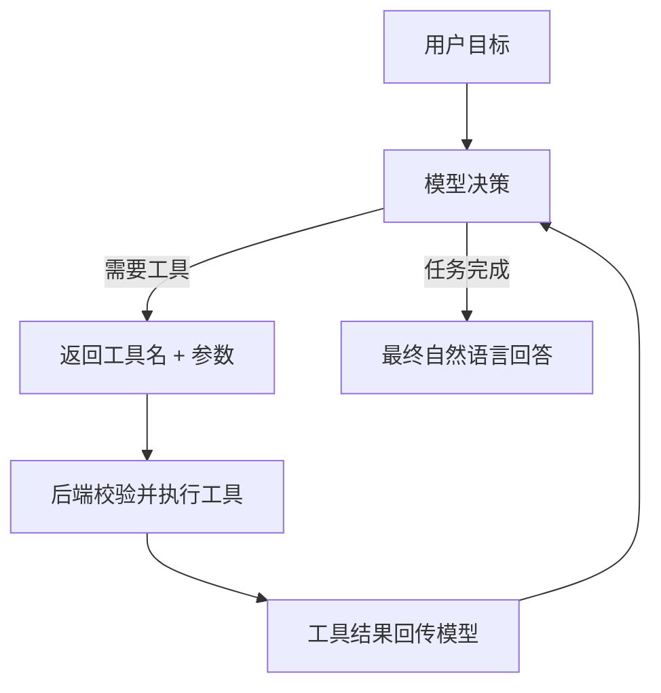

# Agent 与工具调用

## 1. 从问答到行动

普通 Chat 只返回文本；**工具调用（Function Calling）**让模型输出要调用的工具名与参数，由后端真正执行后把结果回传给模型，模型再据此继续。多轮「思考 → 调用 → 观察 → 再思考」即构成 Agent 闭环。



## 2. 工具描述（OpenAI 兼容格式）

```json
{
  "type": "function",
  "function": {
    "name": "search_orders",
    "description": "查询用户订单列表",
    "parameters": {
      "type": "object",
      "properties": {
        "status": { "type": "string", "enum": ["pending", "paid", "shipped"] }
      },
      "required": []
    }
  }
}
```

## 3. 后端执行循环（示意）

```java
public String runAgent(String userQuery) {
    List<LlmMessage> history = List.of(new LlmMessage("user", userQuery));

    for (int step = 0; step < MAX_STEPS; step++) {
        LlmResponse resp = gateway.chatWithTools(history, TOOLS);
        var choice = resp.choices().get(0);

        if (choice.toolCalls().isEmpty()) {
            return choice.message().content(); // 完成
        }

        for (ToolCall call : choice.toolCalls()) {
            // 1. 白名单校验工具名与参数；2. 执行；3. 结果作为 tool 消息回传
            String result = toolRegistry.execute(call.name(), call.arguments());
            history.add(new LlmMessage("tool", result, call.id()));
        }
    }
    throw new BizException("超过最大决策步数");
}
```

## 4. 工程红线（务必遵守）

- **工具白名单 + 参数校验**：模型给出的参数不可信，后端按 schema 校验，拒绝未知工具；
- **副作用动作二次确认**：下单、退款、删除等写操作必须经用户确认，模型不能直接执行；
- **步数与超时上限**：防止模型死循环，限制最大轮次与总耗时；
- **权限继承**：工具执行使用当前登录用户的权限，不放大到系统管理员；
- **全程审计**：记录每步决策、工具入参与结果，便于复盘与排错。

## 5. 适用与不适用

- 适合：信息查询、跨系统编排、客服工单流转、代码辅助；
- 谨慎：复杂多步长任务、强一致性交易、无人值守的高风险操作。

## 实践任务

1. 为实战后端注册一个 `get_server_time` 工具，模型可在需要时调用。
2. 增加工具调用白名单与参数 schema 校验，模拟一次非法参数被拒绝。
3. 画出你设想的下一个工具（如知识库检索、订单查询）的调用链路。
