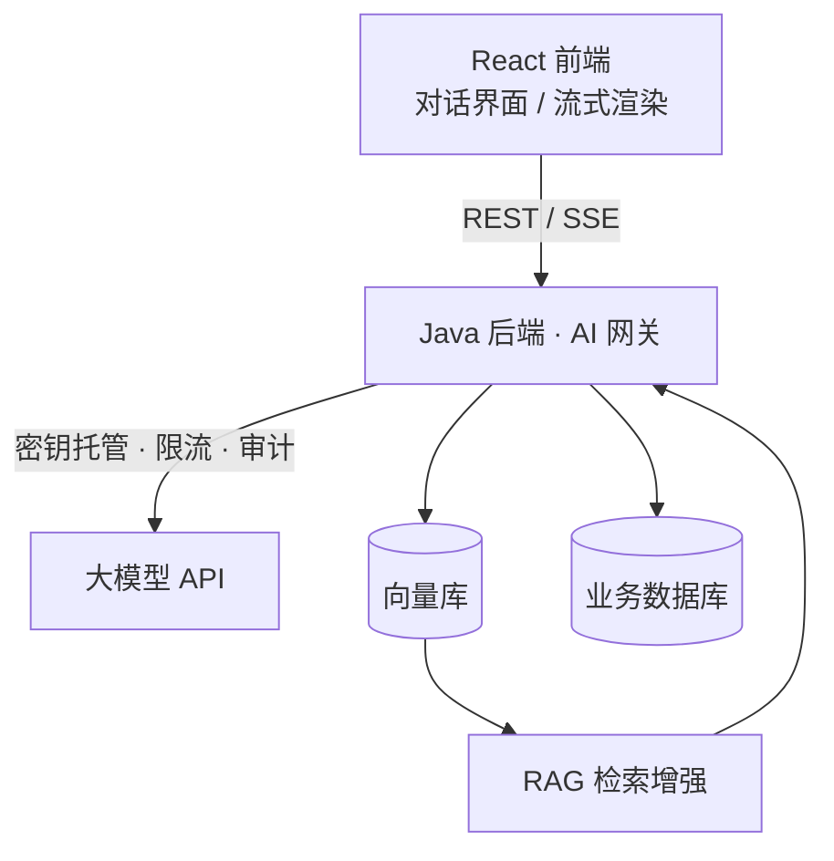

# AI 集成概览

AI FullStack 的核心不是训练模型，而是**把成熟大模型能力稳定、安全地接入业务系统**。本篇给出整体地图。

## 架构视角

## 职责划分

| 层 | AI 相关职责 |
| --- | --- |
| 前端 | 对话 UI、消息渲染、流式增量展示、停止生成、Prompt 输入交互 |
| 后端 | 模型 API 代理、密钥托管、上下文组装、Prompt 模板、限流鉴权、日志审计、RAG 检索编排 |
| 模型侧 | 文本生成、嵌入向量、多模态理解（按需调用） |

## 章节顺序

| 章节 | 主题 | 解决的问题 |
| --- | --- | --- |
| [大模型 API 与 Prompt](./llm-api.md) | 调用兼容协议接口、消息结构、Prompt 工程 | 让模型按预期回答 |
| [RAG 检索增强](./rag.md) | 文档切分、Embedding、向量检索、上下文注入 | 基于私有知识库回答，缓解幻觉 |
| [流式输出 SSE](./streaming.md) | 后端转发模型流、前端逐字渲染 | 降低首字等待体验 |
| [Agent 与工具调用](./agent.md) | 任务规划、工具/函数调用、多步编排 | 让模型驱动业务动作 |

## 工程红线

- **密钥只存后端环境变量**，前端永远不接触模型 API Key；
- 模型输出不可信：业务动作要二次校验，敏感操作不允许模型直接执行；
- 记录 Prompt 与输出日志用于审计与复盘，但需脱敏用户隐私；
- 做好超时、重试与降级：模型不可用时返回友好提示，不拖垮主业务。
