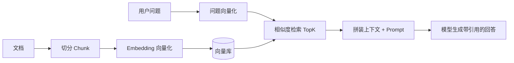

# RAG：检索增强生成

大模型只知道训练截止前的公开知识，也可能「幻觉」编造。RAG（Retrieval-Augmented Generation）在回答前先从私有知识库检索相关片段，把它们作为上下文交给模型，让回答有据可依。

## 1. 流程全景



## 2. 离线建库（索引阶段）

1. **解析文档**：Markdown、PDF、HTML 提取纯文本；
2. **切分 Chunk**：按段落/标题切到合适长度（如 300–500 字），保留上下文重叠避免语义断裂；
3. **Embedding**：调用嵌入模型把每个 chunk 转为向量；
4. **入库**：向量 + 原文 + 元数据（来源、标题）存入向量库。

## 3. 在线检索与注入

```java
@Service
public class RagService {

    private final VectorStore vectorStore; // 向量库客户端
    private final EmbeddingClient embedding;

    public List<RetrievedChunk> search(String question, int topK) {
        float[] qVec = embedding.embed(question);
        return vectorStore.similaritySearch(qVec, topK);
    }

    public String buildContext(List<RetrievedChunk> chunks) {
        StringBuilder sb = new StringBuilder();
        for (int i = 0; i < chunks.size(); i++) {
            sb.append("【资料 ").append(i + 1).append("】")
              .append(chunks.get(i).content())
              .append("（来源：").append(chunks.get(i).source()).append("）\n");
        }
        return sb.toString();
    }
}
```

Prompt 拼装：

```
system: 仅根据下方【参考资料】回答；资料不足时明确说明，不要编造。回答末尾列出引用的资料编号。
context: {buildContext(chunks)}
user: {question}
```

## 4. 提升效果的关键点

- **切分质量**比向量模型更影响召回；按语义边界切分，标题随 chunk 带入；
- **混合检索**：向量相似度 + 关键词（BM25）互补，缓解专有名词召回不足；
- **重排（Rerank）**：检索召回较多片段后，用重排模型取最相关的 TopN；
- **元数据过滤**：按产品、时间、权限范围先过滤再检索；
- **引用溯源**：回答标注资料编号，前端可展示来源链接。

## 5. 与业务库的边界

RAG 适合「非结构化知识」问答；结构化业务数据（订单、余额）仍应通过数据库查询或工具获取，不要指望模型从向量里算出来。

## 实践任务

1. 选取本仓库 `docs/` 若干 Markdown 作为知识库，完成切分与入库脚本。
2. 实现「先检索 → 注入上下文 → 生成回答 → 返回引用来源」的后端接口。
3. 对比有/无 RAG 时，模型对仓库内具体章节的回答准确率。
