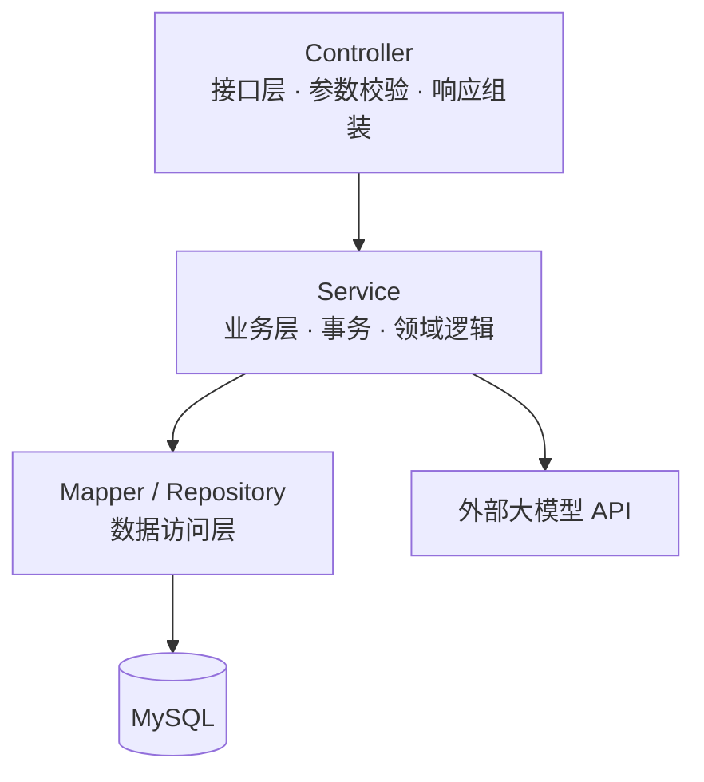

# 后端 Java 概览

后端模块以 **Java 17 + Spring Boot 3** 为主线，构建可对外提供 REST API 的服务端。

## 分层架构

- **Controller**：接收请求、校验参数、调用 Service、返回统一响应；
- **Service**：承载业务逻辑与事务边界；
- **Mapper/Repository**：封装数据库访问；
- 跨层只传递 DTO/领域对象，不在层间暴露实体细节。

## 章节顺序

| 章节 | 主题 | 你将掌握 |
| --- | --- | --- |
| [Java 核心速通](./java-core.md) | 类型、集合、泛型、异常、Lambda 与 Stream | 读懂并编写现代 Java |
| [Spring Boot 入门](./spring-boot-quickstart.md) | 工程结构、依赖注入、REST Controller、统一响应 | 跑起一个 CRUD 风格服务 |
| [持久层](./persistence.md) | MySQL、JPA/MyBatis-Plus、实体与查询 | 完成数据库读写 |
| [鉴权 JWT](./security-jwt.md) | Spring Security、JWT 签发与校验、过滤器 | 保护需要登录的接口 |
| [接口文档](./api-doc.md) | OpenAPI/Swagger 自动生成接口文档 | 前后端可共享的 API 契约 |

## 配套示例

- `examples/backend/ai-chat-api/`：实战项目后端工程，含 Controller、Service、JWT 与模型网关。

## 设计原则

1. **面向接口编程**：Service 定义接口，实现类可替换；
2. **异常统一处理**：业务异常抛出，全局处理器转换为标准错误响应；
3. **配置与代码分离**：环境相关配置走 `application.yml` 与环境变量；
4. **无状态服务**：会话状态放 Token/Redis，服务实例可水平扩展。
