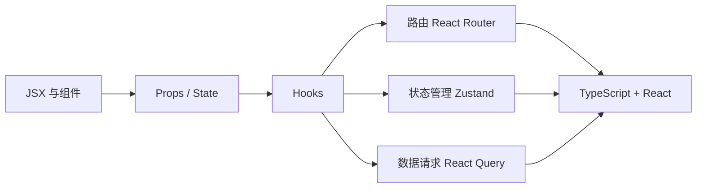

# 前端 React 概览

前端模块围绕「**组件化 UI + 状态驱动视图**」这一核心模型展开，使用 React 18 与 TypeScript。

## 知识点地图

## 章节顺序

| 章节 | 主题 | 你将掌握 |
| --- | --- | --- |
| [React 速通](./react-quickstart.md) | JSX、函数组件、Props、State、事件 | 写出第一个交互式组件 |
| [Hooks 深入](./hooks.md) | useState、useEffect、useMemo、useCallback、自定义 Hook | 管理副作用与派生状态，避免常见性能坑 |
| [路由](./routing.md) | React Router 嵌套路由、动态参数、导航 | 搭建多页面单页应用 |
| [状态管理](./state-management.md) | Zustand 全局状态、与组件状态的边界 | 划分局部状态与共享状态 |
| [数据请求](./data-fetching.md) | Fetch/Axios、React Query 缓存与重试 | 优雅获取后端接口数据 |
| [TypeScript + React](./ts-react.md) | Props/State 类型、泛型组件、Hooks 类型标注 | 类型安全地组织大型前端工程 |

## 配套示例

- `examples/frontend/react-hooks-demo/`：Hooks 与组件交互的可运行示例。
- `examples/frontend/ai-chat-web/`：实战项目前端工程，随课程进度逐步完善。

## 核心心智模型

> React 应用 = **组件树**；视图 = `f(state)`。
> 当状态变化时，React 重新执行组件函数，根据新状态计算出新的虚拟 DOM，再高效地更新真实 DOM。

理解这条主线后，后面所有 API（Hooks、路由、状态库、数据请求）都是在解决「**状态从哪来、怎么变、如何驱动视图**」的不同侧面。
