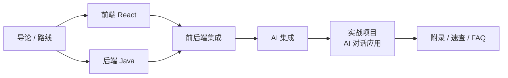

# AI FullStack 工程师教程

本课程面向想系统掌握 **现代全栈开发 + AI 工程化落地** 的工程师，技术主线为：

- **前端**：React 18 + TypeScript + Vite + React Router + Zustand + React Query
- **后端**：Java 17 + Spring Boot 3 + Spring Security + MyBatis-Plus/JPA + MySQL
- **AI 集成**：大模型 API、Prompt 工程、RAG 检索增强、SSE 流式输出、Agent 工具调用
- **工程化**：前后端分离、Docker、Nginx、CI/CD（GitHub Actions）

> 「深入简出」：先讲清楚**为什么这么设计**，再给**可直接运行的代码**，最后用一个**贯穿实战项目**把知识点串起来。所有配套源码位于仓库 [`examples/`](https://github.com/thomaslwq/AIFullStack/tree/main/examples) 目录。

## 为什么是这套技术栈

| 层 | 选型 | 理由 |
| --- | --- | --- |
| 前端框架 | React | 生态最大、组件模型清晰，Hooks 统一了状态与副作用的写法 |
| 类型系统 | TypeScript | 前后端契约在编译期暴露问题，重构成本低 |
| 后端框架 | Spring Boot | 企业级事实标准，依赖注入、事务、安全、数据访问开箱即用 |
| AI 接入 | 模型 API + 自管网关 | 后端统一代理大模型，隐藏密钥、做限流与审计，前端只面对自己的 REST/SSE 接口 |
| 文档站点 | Docusaurus + GitHub Pages | Markdown 即文档，推送即自动构建发布，零运维 |

## 适合人群

- 有任意一门编程语言基础，想转全栈的工程师；
- 后端为主、需要补齐 React 前端能力的 Java 开发；
- 前端为主、想深入 Java 服务端与 AI 集成的开发者；
- 想把大模型能力接入自己产品的独立开发者与技术负责人。

## 课程地图

## 怎么使用本仓库

1. **在线阅读**：站点部署在 GitHub Pages，左侧导航按模块进入。
2. **对照源码**：每篇教程标注对应 `examples/` 下的示例工程，可本地运行调试。
3. **动手实践**：每章末尾给出「实践任务」，建议先自己实现，再对照示例源码。
4. **持续迭代**：新增教程只需在 `docs/` 对应目录添加 Markdown，并在 `website/sidebars.js` 注册；推送到 `main` 分支后，GitHub Actions 会自动构建并发布到 Pages（详见 [附录 · 命令速查](/docs/appendix/commands)）。

## 前置环境

| 工具 | 版本要求 | 用途 |
| --- | --- | --- |
| Node.js | ≥ 18 LTS | 前端构建、文档站运行 |
| JDK | 17+ | 后端编译运行 |
| Maven | 3.9+ | Java 依赖与构建 |
| Git | 任意现代版本 | 版本管理 |
| MySQL | 8.0（可选） | 持久层章节本地练习 |

下一篇：[学习路线图](/docs/roadmap)。
