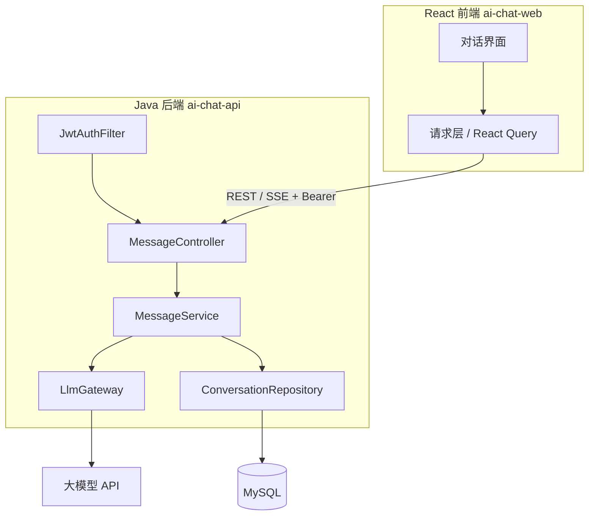

# 实战项目：AI 对话应用总览

项目把前序所有模块串起来：**Java 后端**作为模型网关与鉴权服务，**React 前端**完成多轮对话界面，支持流式输出，预留 RAG 与工具调用扩展位。

## 1. 功能范围

| 模块 | 功能 |
| --- | --- |
| 鉴权 | 登录获取 JWT，受保护接口携带 Token |
| 对话 | 多轮消息记录、发送消息、获取模型回复 |
| 流式 | SSE 逐字渲染，支持停止生成 |
| 历史 | 会话与消息持久化到 MySQL |
| 扩展 | RAG 检索接口、工具调用预留位 |

## 2. 架构与数据流



## 3. 目录映射

```
examples/
├── backend/ai-chat-api/     # Spring Boot 服务
│   ├── controller/  service/  repository/  dto/  common/  config/
└── frontend/ai-chat-web/    # React + Vite + TS
    ├── src/pages/  src/components/  src/stores/  src/api/
```

## 4. 开发顺序

1. [Step 1 · 后端落地](./step1-backend.md)：工程骨架、鉴权、消息接口、模型网关、持久化；
2. [Step 2 · 前端落地](./step2-frontend.md)：工程初始化、登录、对话界面、流式渲染、联调。

## 5. 验收标准

- [ ] 登录后才能访问对话接口，未登录返回 401；
- [ ] 发送消息后获得模型回复，历史消息可回看；
- [ ] 回复以流式逐字展示，可中途停止；
- [ ] 前后端通过统一响应结构交互，错误有友好提示；
- [ ] 后端可容器化启动，前端构建为静态资源由 Nginx 托管。

## 技术栈对照

| 端 | 技术 |
| --- | --- |
| 前端 | React 18、TypeScript、Vite、Zustand、React Router、React Query |
| 后端 | Java 17、Spring Boot 3、Spring Security、JWT、Spring Data JPA、MySQL |
| AI | 兼容协议大模型 API、SSE 流式、RAG/工具调用扩展位 |
| 工程化 | Docker Compose、Nginx、GitHub Actions |
