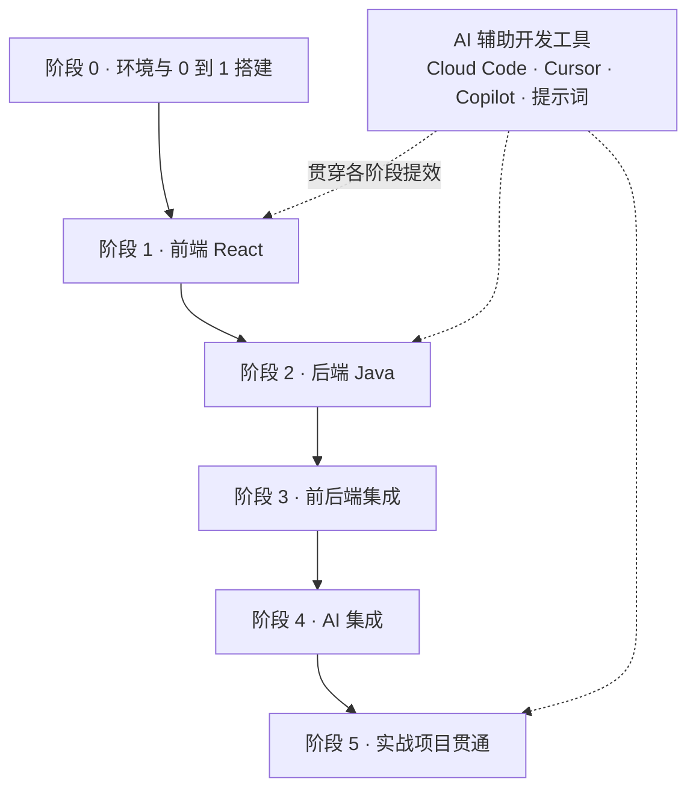

# 学习路线图

课程按「先地基、再分层、后贯通」的顺序推进。每个阶段都有明确的可交付产出，避免只看不动手。

## 阶段总览

## 各阶段目标

| 阶段 | 模块 | 核心内容 | 阶段产出 |
| --- | --- | --- | --- |
| 0 | 环境与起步搭建 | 环境安装校验、Vite + React + TS 初始化、Spring Boot 初始化、前后端联调跑通 | 本地跑起前后端最小闭环 Demo |
| 辅助 | AI 辅助开发 | Cloud Code 容器环境、Cursor、Copilot、全栈提示词模板 | 用 AI 工具提效生成并审查前后端代码 |
| 1 | 前端 React | JSX、组件、Props、State、Hooks、路由、状态管理、数据请求、TS | 一个多页面 React + TS 演示应用 |
| 2 | 后端 Java | Java 核心、Spring Boot、REST、持久层、JWT 鉴权、接口文档 | 一套带鉴权与数据库的 REST 服务 |
| 3 | 集成与工程化 | 接口契约、CORS、统一错误处理、Vite/Docker/Nginx、CI/CD | 前后端联调跑通，镜像可容器化部署 |
| 4 | AI 集成 | 模型 API、Prompt、RAG、SSE 流式、Agent 工具调用 | 后端 AI 网关 + 前端流式对话原型 |
| 5 | 实战项目 | AI 对话应用全流程：架构 → 后端 → 前端 → 部署 | 完整可部署的全栈 AI 应用 |

## 建议节奏

- **有后端基础**：阶段 1 快速过，重点放在组件、Hooks 与前端状态管理；
- **有前端基础**：阶段 2 从 Spring Boot 入手，Java 核心部分按需查阅；
- **零基础**：先完成[零基础起步](bootstrap/env-prepare.md)的环境搭建与最小全栈 Demo，再按阶段顺序推进；每章先跑通示例源码，再完成实践任务；
- **想用 AI 提效**：在进入编码阶段前浏览 [AI 辅助开发](ai-tools/cloudcode-guide.md)，但 AI 生成代码必须理解并审查后再使用。

## 能力自检清单

完成对应阶段后，你应该能独立回答：

- [ ] React：组件之间如何传值？状态提升解决什么问题？Hooks 的依赖数组为什么会引发 bug？
- [ ] Java：Spring Bean 的生命周期与作用域？REST 接口的参数校验与异常如何统一处理？
- [ ] 集成：前后端如何约定接口契约？跨域是浏览器的什么机制导致的？
- [ ] AI：为什么密钥不能放前端？RAG 解决大模型的什么短板？流式输出用什么协议实现？

回到 [课程导论](/docs/intro) 或进入 [前端 React 概览](/docs/frontend/overview)。
